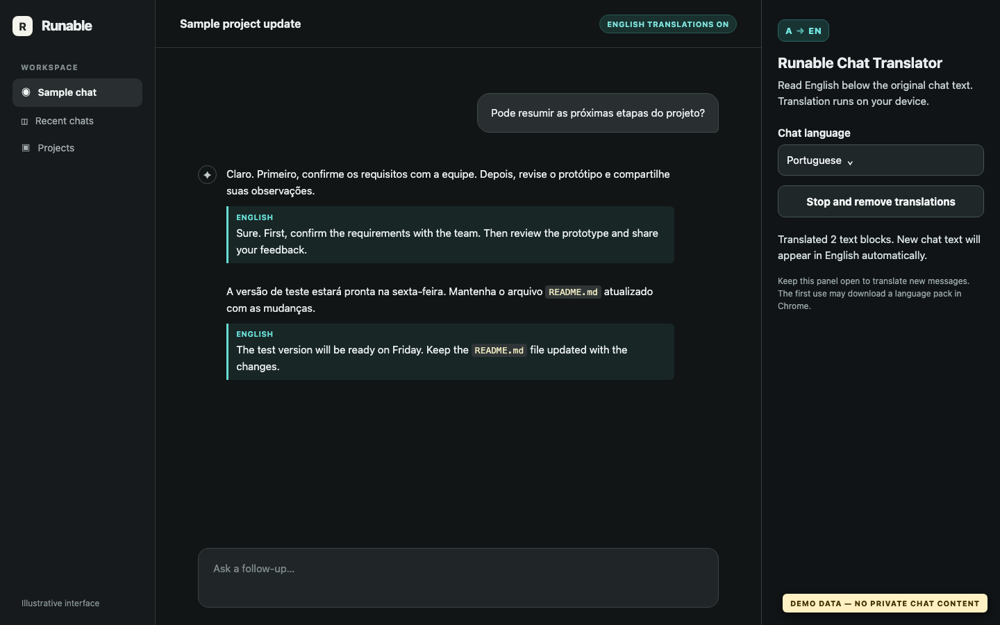
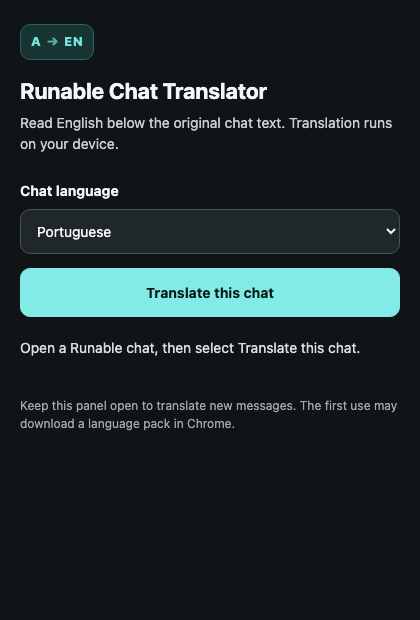

# Runable Chat Translator

A small Chrome extension that adds English translations beneath messages in a Runable chat. The original text stays visible. It uses Chrome's on-device Translator API, so the extension does not send chat text to a translation service.

## Screenshots

These screenshots use sample content; they do not include a private Runable conversation.

| Chat translation | Extension side panel |
| --- | --- |
|  |  |

## Requirements

- Chrome 138 or later on desktop, with the Translator API available.
- A chat at `https://runable.com/chat/…`.
- Internet access on first use if Chrome needs to download the language pack. Translation runs on device after the pack is available.

## Install

1. Download or clone this repository.
2. Open `chrome://extensions` in Chrome.
3. Turn on **Developer mode**.
4. Select **Load unpacked** and choose the `runable-chat-translator` folder containing `manifest.json`.
5. Open a Runable chat, click the extension icon, choose the chat language, and select **Translate this chat**.

The extension can be pinned through Chrome's Extensions menu. Keep its side panel open to translate newly added messages. **Stop and remove translations** clears the English additions from the page.

## How it works

The content script reads visible chat text on `/chat/` pages and watches for new messages. The side panel translates each text block to English with Chrome's built-in Translator API, then the content script displays the result below the original block. Portuguese is selected by default; Spanish, French, German, and Italian are also offered as source languages.

Fenced code blocks, input fields, navigation, and sidebars are skipped. Inline code terms and table cells are included in the surrounding text where possible. Translation quality can vary, especially for proper names and technical terms; compare those with the original text.

## Privacy and permissions

- Site access is limited to `https://runable.com/*`. The content script runs only on Runable chat URLs.
- The extension has no analytics, API key, translation server, or code that sends chat text to a third party.
- `sidePanel` opens the controls; `scripting` lets the panel reattach to a chat after a page or extension reload.
- Chrome may download a language pack on first use. The translation itself runs on your device.

## Troubleshooting

- **No chat text found:** Wait for the chat to load, then select **Stop and remove translations** followed by **Translate this chat**. Make sure the active tab is a Runable chat.
- **Language pack error:** Check Chrome's version and whether its on-device Translator API is available in your profile. Retry with an internet connection so Chrome can download the pack.
- **New messages are not translated:** Keep the side panel open. If the chat tab changed, reopen the panel on the desired Runable chat and start translation again.
- **Chrome's built-in page translation does nothing:** Some Runable chat pages declare `lang="en"` and `translate="no"` even when the visible conversation is Portuguese. This extension reads the chat text directly instead of relying on the page's language metadata.

## Scope

The extension cannot translate text inside images, inaccessible iframes, or messages the page has not loaded. It does not alter the original chat or send messages on your behalf.
